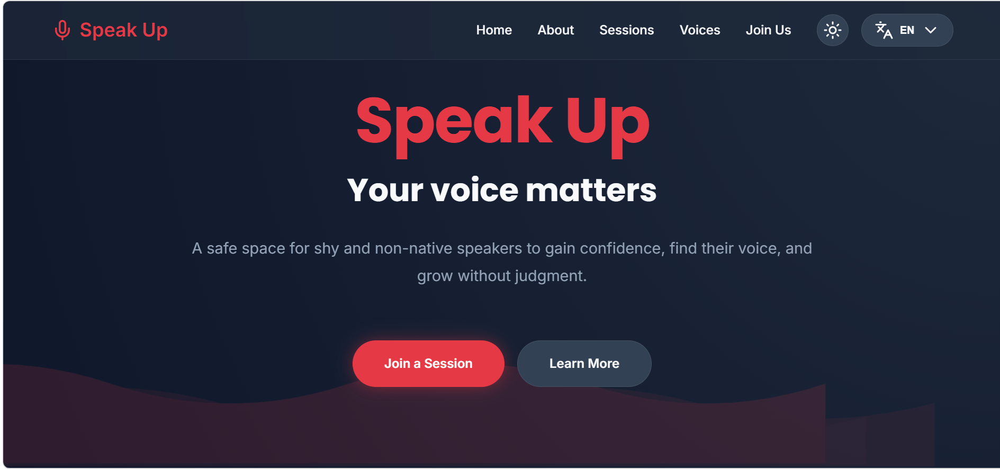
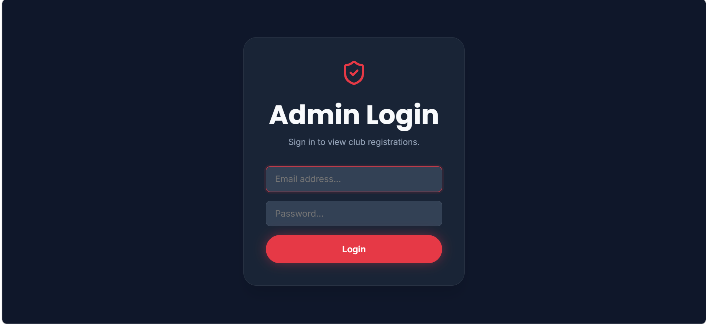
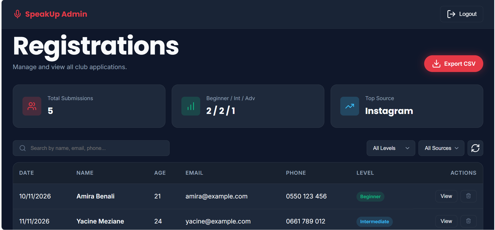

<div align="center">

# 🎤 Speak Up Club — ENS

A modern, multilingual web platform for the **Speak Up** English-speaking club at ENS — a safe, judgment-free space for shy and non-native speakers to practice, grow, and find their voice.

<p align="center">
  
  
  
  
  
</p>

<p align="center">
  Supports <strong>English</strong>, <strong>Arabic (RTL)</strong>, and <strong>French</strong> — with a full <strong>Dark / Light</strong> theme system and a protected <strong>Admin Dashboard</strong> for club officers.
</p>

</div>

---

## 📸 Preview

<div align="center">
  <table>
    <tr>
      <td align="center">
        
        <br /><sub><b>Landing Page</b></sub>
      </td>
      <td align="center">
        
        <br /><sub><b>Admin Panel</b></sub>
      </td>
      <td align="center">
        
        <br /><sub><b>Admin Dashboard</b></sub>
      </td>
    </tr>
  </table>
</div>

---

## ✨ Features

- 🌍 **Trilingual** — English, Arabic (RTL), and French with a one-click language switcher
- 🌗 **Dark / Light Mode** — Theme toggle persisted across visits
- 📱 **Fully Responsive** — Optimized for desktop, tablet, and mobile
- 📝 **Registration Form** — Collects member info and stores it securely via Supabase
- 🔐 **Admin Dashboard** — Protected panel to view, search, filter, delete registrations, and export CSV
- 💬 **Social Integration** — Links to Instagram, TikTok, Facebook, and Telegram

---

## 🛠️ Tech Stack

| | Technology |
|---|---|
| Frontend | HTML5, CSS3, Vanilla JavaScript (ES6+) |
| Icons | Lucide Icons |
| Backend | Supabase (PostgreSQL + Auth) |
| Hosting | Netlify |

---

## ⚙️ Technical Highlights

- Multilingual architecture (EN / AR / FR) with `data-i18n` attribute system
- Automatic RTL layout switching for Arabic
- Supabase Auth protecting the admin panel
- Row Level Security (RLS) — public can only insert, admins can read and delete
- Dynamic dashboard statistics and CSV export
- Scroll-triggered animations via `IntersectionObserver`
- Persistent theme and language preferences via `localStorage`

---

## 🚀 Running Locally

```bash
git clone https://github.com/alaebenghanem/speakUp-club.git
cd speakUp-club
npm run dev   # → http://localhost:3000
```

> Requires a Supabase project — run `supabase_schema.sql` in the SQL Editor and add your credentials to `script.js` and `admin.js`.

---

## 📄 License

MIT — Built with ❤️ for the **Speak Up Club** at ENS.
